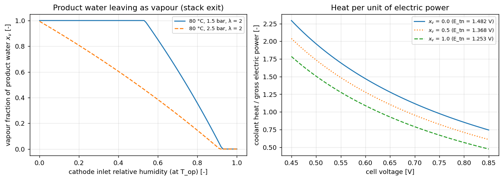

# Hydrogen: Fuel Cell & Tank

PhlyGreen models hydrogen-electric aircraft in two configurations: a pure fuel-cell
(`'Hydrogen'`) and a fuel-cell + battery hybrid (`'FuelCellBattery'`). The model is a
physics-based PEM fuel-cell system (`Systems/FuelCell/FuelCell.py`) plus an optional cryogenic
liquid-hydrogen tank (`Systems/Tank/`).

---

## 1. The polarization curve

The heart of the model is the **cell voltage** as a function of current density, computed with
the analytical **Kulikovsky / Massaro** model (`FuelCell.PolarizationCurve(i, P, T)`). Starting
from the open-circuit voltage \(V_{oc}\), three loss mechanisms are subtracted:

\[
V_{\text{cell}}(j) = V_{oc} \;-\; \underbrace{R_{\Omega}\,j}_{\text{ohmic}}
\;-\; \underbrace{\eta_{0}(j)}_{\text{activation + O$_2$ transport}}
\;-\; \underbrace{V_{\text{conc}}(j)}_{\text{concentration}}
\]

- **Ohmic loss** \(R_\Omega j\) — membrane/contact resistance, linear in current density.
- **Activation + oxygen-transport loss** \(\eta_0(j)\) — the Kulikovsky closed-form for the
  catalyst layer, built from the Tafel slope \(b\), the proton conductivity \(\sigma_t\), the
  catalyst-layer thickness \(l_t\), the reference O₂ concentration and the local oxygen
  diffusivity. The cathode oxygen concentration scales with the **cathode pressure**
  (\(c_h = c_{h,\text{ref}}\,p/p_{\text{ref}}\)), so running the cathode pressurized improves
  performance.
- **Concentration loss** \(V_{\text{conc}}(j) = -B\ln(1 - j/j_{\text{lim}})\) — the steep
  drop as the limiting current density \(j_{\text{lim}}\) is approached.

The cell and chemistry constants come from `FC_Database` (`Systems/FuelCell/FC_Models.py`,
selected via `fc_model`). Plot the curve as in example `20_hydrogen_fuel_cell.py`:

```python
for j in (0.1, 0.5, 1.0, 1.5, 2.0):
    print(j, fc.PolarizationCurve(j, fc.Target_Press))
```

---

## 2. Designing the stack — the role of the design voltage

The fuel-cell stack is sized in `ComputeAndStoreWeights(WTO)`. The key design knob is the
**design cell voltage** \(V_{\text{cell,design}}\) (`v_cell_design`):

1. the **rated net power** \(P_{\text{fc,rated}}\) follows from the design power-to-weight and
   WTO;
2. the **design current density** is the point on the polarization curve at
   \(V_{\text{cell,design}}\) (solved with Brent), bounded by the rated current density
   `i_rated`;
3. the **surface power density** is \(p_s = V_{\text{cell,design}}\cdot j_{\text{design}}\)
   [W/cm²], from which the **total active area**, the **number of cells** \(N_{\text{cells}}\)
   and the per-cell area \(A_{\text{cell}}\) are obtained;
4. the **stack mass** follows from the area-specific power density (`stack_power_density`), and
   the **balance-of-plant** mass is `bop_mass_ratio` × stack, plus motor + PMAD.

There is a genuine **design trade**: a *higher* design voltage runs each cell at a lower
current density (locally more efficient), but needs more active area / a heavier stack to make
the rated power — and a heavier powertrain needs more hydrogen, which needs a bigger stack, so
the design can **snowball**. The result is a take-off-weight **optimum** at a moderate design
voltage (very high voltages fail to close). Example `21_hydrogen_design_voltage_sweep.py` sweeps
it.

```python
energy = EnergyConfig(
    Ef=120e6,                       # hydrogen lower heating value [J/kg]
    eta_gearbox=0.96, eta_pmad=0.99, eta_electric_motor=0.96,
    fc_model='PEMFC_GoodPerformance',
    i_rated=2.5,                    # rated current density [A/cm^2]
    v_cell_design=0.5,              # design cell voltage [V]  <-- the key sizing knob
    stack_power_density=3000,       # area-specific stack power [W/kg]
    bop_mass_ratio=0.40,            # balance-of-plant / stack mass
)
```

---

## 3. The air system (compressor) and net system efficiency

PEM fuel cells run the cathode **pressurized**, which costs parasitic power. The air system
(`_compute_air_system_power`) sizes a **compressor** to raise ambient air to the cathode
pressure and a **turbine** that recovers part of the energy from the pressurized exhaust:

\[
\dot m_{\text{air}} \propto N_{\text{cells}}\,I\,\lambda, \qquad
P_{\text{comp}} = \frac{\dot m_{\text{air}}\,c_{p}\,T_{\text{amb}}\,(\Pi^{0.286}-1)}{\eta_{\text{comp}}},
\qquad
P_{\text{comp,net}} = P_{\text{comp}} - P_{\text{turb}}
\]

with stoichiometry \(\lambda\), pressure ratio \(\Pi = p_{\text{cathode}}/p_{\text{amb}}\). The
compression demand grows with altitude (lower \(p_{\text{amb}}\)), so it is a real part of the
operating-point dependence.

The **net system efficiency** is the gross stack power minus the air-system (and PMAD) parasitics
over the hydrogen chemical power:

\[
\eta_{\text{sys}} = \frac{P_{\text{gross}} - P_{\text{comp,net}}}{\dot m_{\text{H}_2}\,\text{LHV}},
\qquad P_{\text{gross}} = N_{\text{cells}}\,V_{\text{cell}}\,I .
\]

For the mission, `ComputePRatio(alt, vel, P_net)` solves for the operating current density that
delivers the required **net** shaft power at the current flight condition and returns the
hydrogen *chemical* power required (i.e. \(1/\eta_{\text{sys}}\) of the net power), so the
mission integrates hydrogen energy consistently.

---

## 4. Heat management

A fuel cell is roughly half-efficient, so it rejects a large heat load. The heat the coolant
must reject is the difference between the thermo-neutral voltage and the operating cell
voltage. The thermo-neutral voltage depends on the phase in which the product water leaves
the stack: 1.48 V if it leaves as liquid (HHV), 1.25 V if it leaves as vapour (LHV). Vapour
carries its latent heat away with the cathode exhaust, so that heat never reaches the coolant.
With \(x_v\) the fraction of the product water that leaves as vapour:

\[
Q_{\text{thermal}} = N_{\text{cells}}\,I\,\Big(\frac{\Delta H_{HHV} - x_v\,(\Delta H_{HHV} - \Delta H_{LHV})}{2F} - V_{\text{cell}}\Big)
\]

### Why product water at 80 °C can leave as vapour

The 100 °C "boiling point" is the temperature at which the saturation pressure of water equals
1 atm, so that *pure* water boils. Water evaporates at any temperature into a gas mixture,
provided the partial pressure of the vapour stays below the saturation pressure at that
temperature (Dalton's law). This is why laundry dries at room temperature. The cathode channel
of a fuel cell is exactly such a mixture: air flowing past the electrodes, into which the
product water can evaporate.

At the stack temperature \(T_{op}\) the gas can hold vapour up to the saturation partial
pressure \(p_{sat}(T_{op})\). At a total cathode pressure \(P\), the largest vapour mole
fraction is therefore \(y_{sat} = p_{sat}(T_{op})/P\). For the database stacks
(\(T_{op}\) = 80 °C, \(P\) = 1.5 bar): \(p_{sat}\) = 47.3 kPa and \(y_{sat}\) = 0.315. That is,
up to 31.5 % of the exhaust molecules can be water vapour.

Whether that is enough depends on how much air flows through the cathode. This is set by the
**air stoichiometric ratio** \(\lambda\) (`FuelCell.stoich`, default 2): the oxygen supplied
divided by the oxygen the reaction consumes. \(\lambda\) = 1 would supply exactly the oxygen of
the reaction; \(\lambda\) = 2 supplies twice that, and the excess leaves with the exhaust.

Per mole of hydrogen reacted, \(\mathrm{H_2 + \tfrac12 O_2 \rightarrow H_2O}\):

| Quantity | Expression | λ = 2 |
|---|---|---|
| oxygen consumed | \(0.5\) mol | 0.5 mol |
| air supplied (21 % O₂ by mole) | \(n_{air} = 0.5\,\lambda / 0.21\) | 4.76 mol |
| dry gas leaving the cathode | \(n_{dry} = n_{air} - 0.5\) | 4.26 mol |
| product water | 1 mol | 1 mol |
| vapour the exhaust can carry | \(n_{v,max} = \dfrac{y_{sat}}{1 - y_{sat}}\, n_{dry}\) | 1.96 mol |

The exhaust can carry about twice the product water. If all of it evaporates, the exhaust
leaves with a vapour mole fraction of 1/(1 + 4.26) = 0.19, a partial pressure of 28.5 kPa, i.e.
60 % relative humidity at 80 °C. That is below saturation, so nothing forces the water to
condense. The energy to evaporate it, the latent heat \(\Delta H_{HHV} - \Delta H_{LHV}\)
= 44.2 kJ/mol, is taken from the stack. It leaves with the exhaust instead of reaching the
coolant.

If the inlet air is humidified to a relative humidity \(\phi_{in}\) (at \(T_{op}\)), it already
brings \(n_{w,in} = \dfrac{\phi_{in}\,p_{sat}}{P - \phi_{in}\,p_{sat}}\,n_{air}\) mol of vapour, and
the capacity left for the product water shrinks. The vapour fraction of the product water is

\[
x_v = \min\!\Big(1,\; \max\big(0,\; n_{v,max} - n_{w,in}\big)\Big) ,
\]

computed by `FuelCell.product_water_vapour_fraction` with
`EnergyConfig.fc_cathode_inlet_rh` (default 0, dry inlet). For the database stacks \(x_v\) = 1
up to \(\phi_{in}\) ≈ 0.5. It then falls quickly: 0.61 at 0.7, 0.36 at 0.8 and 0.08 at 0.9. A
higher cathode pressure lowers \(y_{sat}\) and a lower \(\lambda\) lowers \(n_{dry}\); both
reduce \(x_v\) (at λ = 1.5 the capacity is 1.41 mol). Above the boiling point at the cathode
pressure (≈ 112 °C at 1.5 bar, e.g. a high-temperature PEM at 170 °C) the exhaust cannot
saturate, and all product water is vapour.

Two caveats. First, this is an equilibrium capacity at the stack exit. Locally, liquid water
can still form (electrode flooding, cold spots), and the exhaust may leave sub-saturated, so
\(x_v\) is an upper bound on the vaporised fraction. Second, what matters for the
thermal-management system is the water state at the **system** exit, after any humidifier
(which recovers water and heat from the exhaust) and the expander. That system-level water
balance is not modelled yet. Set `EnergyConfig.fc_product_water_vapour_fraction` to a number
(0 = all liquid, the HHV basis) to override the computed value. The hydrogen consumption does
not depend on \(x_v\); only the heat sent to the TMS does.

{ width="760px" }

Left: the vapour fraction at the stack exit against the cathode inlet humidity. Right: the
coolant heat per unit of gross electric power against the cell voltage, for liquid,
half-vaporised and vapour product water.

Because \(V_{\text{cell}}\) falls with load and altitude, the heat load peaks where the system
works hardest. The weight loop sizes the **thermal-management mass** (`WHeat_Exchanger`) with one
of two models, selected by `TMSConfig(tms_class=...)`:

- **Class I** (default): the peak heat over the mission *and* the take-off/OEI point, divided by a
  **specific power** (heat per kg of HEX),
  \(W_{\text{cool}} = Q_{\text{peak}} / \text{HEX specific power}\), with
  `EnergyConfig.hex_specific_power_h2` defaulting to **5000 W/kg** (vs ~1500 W/kg for a battery
  HEX rejecting to ambient — see [Battery](battery.md)).
- **Class II**: geometric coolant → LH2 and coolant → ram-air heat exchangers, a coolant pump
  (an electrical load on the fuel cell) and the ram-air duct drag (added to the polar), sized
  over the mission. See [Thermal Management](thermal-management.md).

A multi-MW fuel cell rejects a large heat load, so the TMS is a significant mass.

---

## 5. Mission and weight closure

`Mission.HydrogenConfiguration` integrates the hydrogen chemical energy over the mission, and
the weight loop `Weight.Hydrogen` closes the take-off weight over

\[
W_{TO} = W_{\text{struct}} + W_{\text{FC system}} + W_{\text{H}_2} + W_{\text{tank}}
         + W_{\text{cooling}} + W_{\text{payload}} + W_{\text{crew}} + W_{\text{reserve}} .
\]

The hydrogen load is the hydrogen energy of the flown profile and of the ground segments
(taxi, take-off; see [Mission](mission.md)) divided by `Ef`, increased by
`EnergyConfig.h2_fuel_margin` (default 0.05: unusable/residual hydrogen and feed system). The
final reserve (`contingency_fuel`, else 5 % of the load) is carried in the tank too: the tank is
sized for **load + reserve**.

**Fuel-cell sizing is self-consistent and constraint-aware.** Inside each weight iteration the
stack is *not* sized to the mission peak alone: it is sized to the worst case of the **mission
peak, the take-off** (field length) **and the OEI climb** — the latter two evaluated at the
constraint conditions, since they are not flown by the mission profile but the fuel cell must
still supply their power. To keep the *flown* fuel cell and the *weighed* fuel cell the same,
the loop is `SizeFromConstraint` (seed) → fly → `SizeForPropulsivePower(max(mission, take-off,
OEI))` → re-fly until the required power converges. A single, explicit margin
(`FuelCell.SizingMargin`, default 1.0) is applied — there are no hidden oversizing factors.

See example `20_hydrogen_fuel_cell.py`.

---

## 6. Cryogenic LH2 tank

Hydrogen is stored as a cryogenic liquid (~20 K). `Systems/Tank/` provides `LH2_Tank`:
structural + multi-layer-insulation (MLI) sizing (after Svensson et al.) and a transient
`time_step` model of the tank thermodynamic state:

- **heat ingress** through the insulation slowly boils the liquid and **self-pressurizes** the
  tank;
- a **vent valve** opens at the maximum pressure \(P_{\max}\) (venting gas, a fuel loss);
- a **heater** adds power at the minimum pressure \(P_{\min}\) to keep feed pressure up.

It requires **CoolProp** (para-hydrogen properties) and is therefore optional: with a
`TankConfig` and CoolProp installed it is used for sizing (reporting the **gravimetric index**
H₂/(H₂+tank), geometry and pressure limits); otherwise a simple gravimetric-index mass model is
used so the design always closes.

```python
from PhlyGreen.config import TankConfig
config.tank = TankConfig(max_diameter=2.4, number_of_tanks=1, tank_model='Svensson_Default')
```

To watch the tank state evolve over the mission, switch on tracking and re-fly:

```python
aircraft.configure(config)                       # sizes the tank
aircraft.mission.track_tank = True
aircraft.mission.EvaluateMission(aircraft.weight.WTO)
from PhlyGreen import postprocess as pp
pp.plot_tank_state(aircraft)                      # pressure / mass / vent vs time
```

See example `22_hydrogen_tank.py` and notebook `03_hydrogen_fuel_cell.ipynb`.

---

## 7. Fuel cell + battery hybrid

`'FuelCellBattery'` splits the propulsive power between the fuel cell and a (Class-I) battery
via the profile's supplied-power ratio φ (the battery fraction). The fuel cell uses its physics
efficiency above; the battery is sized from its energy and power needs. The fuel cell is sized
(by the same self-consistent loop as the pure-hydrogen path) to the worst of its *own share*
`(1−φ)` of the mission peak, take-off and OEI — so a larger φ *shrinks the stack*, but never
below the `(1−φ)` share of the take-off/OEI floor. Because the battery stores little energy per
kg, hybridization helps short power-limited segments more than sustained cruise. A φ = 0
`FuelCellBattery` design reproduces a pure `Hydrogen` design exactly.

**When does a battery pay?** A battery makes the aircraft lighter only if it lowers the power
that sizes the fuel cell by more than its own mass (plus the snowball) costs. Example
`23_fuelcell_battery_hybrid.py` shows the two conditions on the ATR 42-600 reference:

- **The take-off must size the fuel cell.** On the baseline 1,107 m field the climb needs more
  power than the take-off (3.0 vs 2.8 MW), so a take-off battery removes no stack mass and every
  battery share makes the aircraft heavier. On an 800 m field (the ATR 42-600S short-field
  version) the take-off needs 3.9 MW against 3.4 MW for the climb.
- **The battery must be a power battery.** A battery on the take-off only (under a minute) is
  sized by its specific power and stays small. A battery that also covers the ~27-minute climb
  is sized by energy and never pays, on either field.

On the 800 m field the optimum take-off share follows from the power balance,
\(\varphi^* = 1 - P_{\text{climb}}/P_{\text{take-off}} = 0.15\), where the battery brings the fuel
cell's take-off load down to its climb load. The sweep finds the lightest design at exactly
φ = 0.15: 758 kg (3 %) lighter than pure hydrogen, with a stack 545 kg lighter and a 382 kg
battery. Beyond φ* the climb sizes the fuel cell again and the battery only adds mass.

---

## 8. Thermal management

The fuel-cell heat is rejected by the thermal-management system, `aircraft.tms`: Class I
(specific power) or Class II (geometric coolant → LH₂ and coolant → ram-air heat exchangers,
pump and ram-air drag, sized over the mission). See [Thermal Management](thermal-management.md)
and tutorial 08. `Systems/Thermal/network.py` also keeps a generic heat-source / heat-sink
balance scaffold (`HeatSource`, `HeatSink`, `HeatExchangerNetwork`) for studies.

---

## References

- Kulikovsky, A. A. *A physically–based analytical polarization curve of a PEM fuel cell.*
  Electrochemistry Communications, 6(10):1069–1077, 2004.
- Massaro, M.C. et al. *Optimal design of a hydrogen-powered fuel cell system for aircraft applications.* Energy Conversion and Management, 306:118266, 2024.
- Svensson, C. et al. *Modelling hydrogen fuel cell aircraft in SUAVE.* ICAS 2024.
