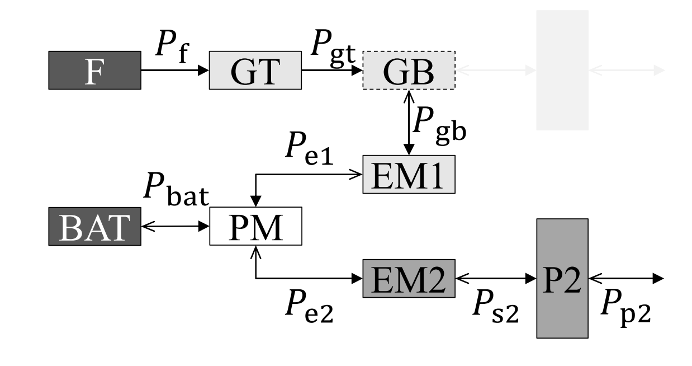
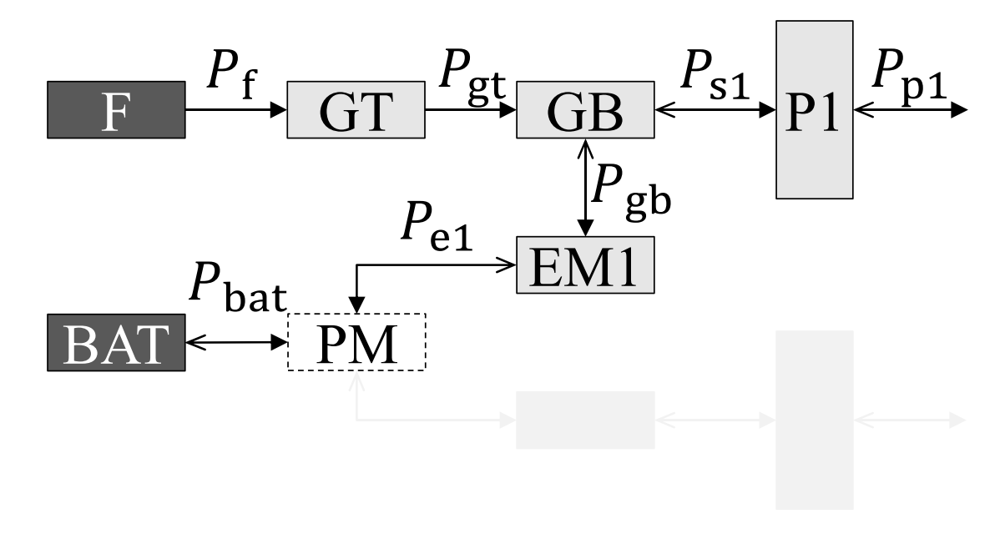

# Powertrain Module

The **Powertrain** module computes powertrain performance throughout the mission and distributes power across thermal and electrical subsystems depending on the aircraft configuration (Traditional, Serial Hybrid, or Parallel Hybrid).  

---

## Overview

The Powertrain model:

- Converts a given **propulsive power requirement** into **fuel power** and **electric power** (the latter if hybrid)
- To do so, it builds architecture-specific powertrain efficiency-chains using components efficiencies (see the [Theoretical Reference](../getting-started/theory.md/))
- Components efficiencies are computed based on the current flight conditions, if a model is provided. Otherwise, constant, user-specified values are used.
- Presently, the available component models are:
    - Hamilton model for **propeller efficiency**, computed as a function of true airspeed, altitude, and power request 
    - An RBF **gas-turbine response surface** for **thermal efficiency** vs design power, altitude, Mach and power request (runtime model `Systems/Powertrain/gas_turbine_surrogate.py`, fitted offline by `train_gas_turbine_surrogate.py`)
    - A d-q **electric-motor** model (`EM.py`) and two **propeller** models: the analytic Hamilton-Standard model (`propeller_hamilton.py` + `propeller_hamilton_tables.py`) and a data-trained RBF surrogate (`propeller_surrogate.py`)
- Computes **powertrain mass** from subsystem specific powers
- Provides a **GT engine power-lapse** with altitude, to be used for constraint evaluation and engine rating

The powertrain system performance is evaluated at every timestep during the Mission integration.

---

## Component efficiency models

Each component's efficiency is an **`EfficiencyModel`** (`Systems/Powertrain/efficiency.py`)
evaluated through one accessor:

```python
eta = powertrain.eta('gas_turbine', altitude, velocity, power, rpm)
```

Internally each call builds an `OperatingPoint(altitude, velocity, power, rpm)` and passes it
to that component's model. `power` is the power through **that component** (all engines
together; the models divide by `powertrain.n_engines`, set by
`PropellerInput['Number of Engines']`, default 2):

| Component | Power passed to its model |
|---|---|
| `gas_turbine` | shaft output |
| `propeller` | shaft input (gearbox output) |
| `electric_motor` | shaft output |
| `generator` (serial hybrid) | electrical output |
| `gearbox`, `pmad` | input (sum of the inputs where they combine two flows) |
| `fuel_cell` | net electrical output |

The component powers depend on the efficiencies, so `Powertrain.Traditional`, `Hybrid` and
`PowerRatioFuelCellBattery` solve the graph a few times: first with every model at the
propulsive power, then with each model at the component power of the previous solution, until
the powers the models are read at match the solved ones (relative tolerance 1e-6, at most 50
passes). The step is damped: whenever a component's step changes sign, it is halved. A
propeller at low power has an efficiency that rises steeply with its shaft power, and the
undamped iteration oscillates there. A warning is issued if the 50 passes are not enough, for
example when the demand exceeds the thrust power the propeller model can deliver at that flight
condition. With constant efficiencies the first solution is returned, so Class-I results are
unchanged bit for bit.

Two fidelities are available **per component**:

- **Class‑I — `ConstantEfficiency`** (the default): a fixed user value, independent of the
  operating point. This reproduces the legacy behaviour exactly and is what the golden
  regression cases use.
- **Class‑II — operating‑point‑dependent**: efficiency varies with altitude / velocity /
  power / rpm via a physics model or a fitted response surface.

You select the model **per component** in `EnergyInput` (typed: `EnergyConfig`):

```python
EnergyInput = {
    'Eta Gas Turbine Model':   'ResponseSurface',  # or 'constant' (+ 'Eta Gas Turbine')
    'Eta Electric Motor Model':'Smart',            # d-q model, or 'constant'
    'Eta Propulsive Model':    'Hamilton',         # or 'Surrogate' (RBF), or 'constant'
    # Class-II GT/EM also need a *nominal* (design) power, fixed before the mission:
    'GT Design Power': 8.5e6,   'EM Design Power': 1.5e6,
    'EM Design Voltage': 800.0, 'EM Design RPM': 11000.0,
}
```

The available Class‑II models are:

### Gas turbine — `GasTurbineEfficiencyModel`
Wraps a **universal** RBF response surface (`gas_turbine_surrogate.py`,
`GasTurbineResponseSurface`) trained offline by `train_gas_turbine_surrogate.py` from a
pycycle turboshaft map. The map is *size‑independent* (efficiency vs altitude, Mach and power
fraction for one reference engine). At run time:

1. the available shaft power lapses with altitude (ISA pressure ratio): \(P_{\text{avail}} =
   P_{\text{design}}\,\delta(h)\);
2. the efficiency is read at the current **power fraction** \(P_{\text{req}}/P_{\text{avail}}\);
3. it is then **scaled to the actual engine size** — smaller engines are less efficient — via
   \((1-\eta) = (1-\eta_{\text{ref}})\,(P_{\text{ref}}/P_{\text{design}})^{n}\), with the
   exponent \(n\) calibrated once from real turboshaft SFC‑vs‑power data (\(n = 0.0556\);
   0.068 without the D‑25V row, which lies far below the trend).

`GasTurbineResponseSurface.predict` clips its inputs to the training box of the map
(0–30,000 ft, Mach 0.01–0.6, power fraction 0.3–1.0, stored in the pickle as `input_ranges`)
and issues a `RuntimeWarning` the first time each coordinate is clipped (once per surrogate
instance). Below a fraction of 0.3 it therefore returns the 0.3 efficiency, which is
optimistic towards idle. A requirement above \(P_{\text{avail}}\) is capped at a fraction of 1
and flagged as power-limited. If the inputs are invalid (non-positive design power, NaN power
or Mach) or the evaluation fails, it returns a constant 0.30 with a `RuntimeWarning` instead of
failing silently.

The model works as a *percentage of a nominal power*, so the engine is rated with the map's own
lapse: with the Class-II map, `Powertrain.PowerLapse` returns the deck's ISA pressure ratio
\(\delta(h)\) (no Mach or ISA-deviation dependence, as in the deck) instead of the Ruijgrok
\((\rho/\rho_0)^{0.75}\) used for constant efficiencies. It sets the constraint diagram (through
`SizingDenominator`) and the engine rating, which is the largest
\(P_{\text{shaft}}/\delta(h)\) over the mission points (`mission.Max_PEng_lapsed`) and the
take-off / OEI shaft power referred to sea level.

Without an explicit `GT Design Power` the nominal **follows the rating**: the weight loop
(`Weight._mission_and_powertrain`) seeds it with `DesignPW * WTO`, flies the mission, rates the
engine, sets the nominal to the rating and re-flies until they agree (relative 1e-7, a few
passes). The engine that flies is then the one that is weighed, and no mission point exceeds
the map's full power (the sizing point runs at a fraction of 1). An explicit `GT Design Power`
is kept as a fixed nominal; `powertrain.report_class_ii_sizing()` flags power-limiting at
altitude, and warns when the nominal differs from the rating by more than 5 %
(`Powertrain.GT_NOMINAL_RATING_RTOL`), since a nominal above the rating reads the map at a lower
load and a larger engine size without weighing that engine — see example
`16_class_ii_propulsion_sizing.py`.

### Electric motor — `MotorEfficiencyModel`
Wraps the d‑q `ElectricMotor` physics model (`EM.py`): given the design power, voltage and
rpm it returns efficiency as a function of the operating point (copper, iron and switching
losses), so the battery power ratio changes with load. Also needs a fixed nominal power,
`EM Design Power`, which is a **mechanical** (shaft-output) rating: `report_class_ii_sizing()`
compares it with the peak motor shaft power `max(Max_PMotor, TO_PMotor)`. With `'Smart'` (or
`powertrain.em_model`) the model acts on the parallel motor, the serial propulsion motor and the
fuel-cell motor; the serial generator is the separate `'generator'` entry of
`powertrain.efficiency` (constant `Eta Electric Motor 1` unless replaced).

### Propeller — `HamiltonPropellerEfficiency` / `PropellerSurrogateEfficiency`
Two interchangeable models: the analytic **Hamilton‑Standard** method
(`propeller_hamilton.py` + `propeller_hamilton_tables.py`) and a data‑trained **RBF
surrogate** (`propeller_surrogate.py`, needs pandas), both giving propeller efficiency vs
true airspeed, altitude and shaft power (and, for the surrogate, blade pitch / rpm). The
surrogate runs at `Propeller RPM` (`EnergyConfig.propeller_rpm`, default 1200 rpm).

All of these (plus the electric motor) can be plotted as efficiency maps in example
`05_powertrain_graph_and_efficiency_models.py`.

---

## Power Ratios

The main objective of the powertrain module is to compute the fuel/battery power required to deliver a certain propulsive power. At any instant in time, the required **propulsive power** is computed by the Mission module (see [Mission](mission.md#mission-power-calculation)):

\[
P_{prop}(t)= W_{TO}
\left[
\frac{q V}{W_{TO}/S}\, C_D(C_L, M)
+ \beta P_s
\right]
\]

where \(q\) is the dynamic pressure, \(W_{TO}\) is the takeoff weight, \(S\) is the wing area, \(C_D(C_L, M)\) is the drag coefficient given by the polar model, \(\beta\) is the weight fraction, and \(P_s\) is the power excess required for climb.

Depending on the powerplant architecture, the required fuel/battery powers are computed as follows:

---

### 1. Traditional 
The system solves for the following power ratios:

- \( \displaystyle \frac{P_f}{P_p} \): fuel power to propulsive power  
- \( \displaystyle \frac{P_{gt}}{P_p} \): gas-turbine shaft power to propulsive power  
- \( \displaystyle \frac{P_{gb}}{P_p} \): gearbox output power to propulsive power  
- \( \displaystyle \frac{P_p}{P_p} = 1 \): reference value

These represent the **power chain**:

**Fuel → Gas Turbine → Gearbox → Propeller → Propulsive Power**

The power flow is represented as:

\[
A\,x = b ,
\]

where the **upper-triangular matrix** \(A\) is:

\[
A =
\begin{bmatrix}
-\,\eta_{GT} & 1 & 0 & 0 \\
0 & -\,\eta_{GB} & 1 & 0 \\
0 & 0 & -\,\eta_{PP} & 1 \\
0 & 0 & 0 & 1
\end{bmatrix},
\qquad
b =
\begin{bmatrix}
0 \\ 0 \\ 0 \\ 1
\end{bmatrix}.
\]

where \(\eta_{GT}\), \(\eta_{GB}\), and \(\eta_{PP}\) are the gas-turbine, gearbox, and propeller efficiencies, respectively. The solution vector \(x\) is:

\[
x =
\begin{bmatrix}
P_f/P_p \\
P_{gt}/P_p \\
P_{gb}/P_p \\
1
\end{bmatrix}.
\]

Because \(A\) is upper-triangular, the solution corresponds to the sequential efficiency chain.


1. Gearbox <- Propeller

\[
\frac{P_{gb}}{P_p} = \frac{1}{\eta_{PP}}
\]

2. Gas Turbine <- Gearbox

\[
\frac{P_{gt}}{P_p} = \frac{1}{\eta_{GB}\,\eta_{PP}}
\]

3. Fuel <- Gas Turbine

\[
\frac{P_f}{P_p} = \frac{1}{\eta_{GT}\,\eta_{GB}\,\eta_{PP}}
\]

Thus, the system computes the **inverse cumulative efficiencies** needed to deliver \(P_p\).
The calculation is performed using the following code, that solves the linear system \(A\,x = b\):


!!! note "Assembled by the component graph"
    These linear systems are no longer hand-coded. `Systems/Powertrain/graph.py` assembles
    them from composable primitives (`converter`, `combiner`, `split`, `sink`); the
    solution is identical. Adding a new architecture (e.g. fuel cell + battery) is a new
    composition of those primitives — no new matrix algebra. Each component efficiency is
    an `EfficiencyModel` evaluated through `Powertrain.eta(component, alt, vel, pwr)`.

yielding the power ratios vector: \(P_f/P_p, \ P_{gt}/P_p, \  P_{gb}/P_p, \  P_p/P_p\).
Every component efficiency can be **Class-I** (a constant, the default) or **Class-II** (a
model that depends on altitude/velocity/power/rpm), selected per component in the
`EnergyInput`:

```python
EnergyInput = {
    'Eta Propulsive Model': 'Hamilton',        # or 'Surrogate' (RBF), or 'constant'
    'Eta Gas Turbine Model': 'ResponseSurface', # or 'constant'
    'Eta Electric Motor Model': 'Smart',        # d-q model, or 'constant'
    # ... other options
}
```

---

### 2. Serial Hybrid 
The system solves for the following power ratios:

- \( \displaystyle \frac{P_f}{P_p} \): fuel power to propulsive power  
- \( \displaystyle \frac{P_{gt}}{P_p} \): gas-turbine shaft power to propulsive power  
- \( \displaystyle \frac{P_{gb}}{P_p} \): gearbox output power to propulsive power  
- \( \displaystyle \frac{P_{e1}}{P_p} \): electric generator power to propulsive power  
- \( \displaystyle \frac{P_{e2}}{P_p} \): electric motor power to propulsive power  
- \( \displaystyle \frac{P_{bat}}{P_p} \): battery power to propulsive power  
- \( \displaystyle \frac{P_{s2}}{P_p} \): shaft power to propulsive power  
- \( \displaystyle \frac{P_p}{P_p} = 1 \): reference value

with reference to the **power chain** in the image below:

{ width="300px" }

The power flow is represented as:

\[
A\,x = b ,
\]

where the matrix \(A\) is:

\[
A =
\begin{bmatrix}
-\eta_{\mathrm{GT}} & 1 & 0 & 0 & 0 & 0 & 0 & 0 \\[6pt]
0 & -\eta_{\mathrm{EM1}} & 0 & 1 & 0 & 0 & 0 & 0 \\[6pt]
0 & 0 & 0 & -\eta_{\mathrm{PM}} & 1 & -\eta_{\mathrm{PM}} & 0 & 0 \\[6pt]
0 & 0 & 1 & 0 & -\eta_{\mathrm{EM2}} & 0 & 0 & 0 \\[6pt]
0 & 0 & -\eta_{\mathrm{GB}} & 0 & 0 & 0 & 1 & 0 \\[6pt]
0 & 0 & 0 & 0 & 0 & 0 & -\eta_{\mathrm{PP}}(h,V,P) & 1 \\[6pt]
\phi & 0 & 0 & 0 & 0 & \phi - 1 & 0 & 0 \\[6pt]
0 & 0 & 0 & 0 & 0 & 0 & 0 & 1
\end{bmatrix}
\]

\[
b =
\begin{bmatrix}
0 \\ 0 \\ 0 \\ 0 \\ 0 \\ 0 \\ 0 \\ 1
\end{bmatrix}
\]

 The solution vector \(x\) is:

\[
x =
\begin{bmatrix}
P_f/P_p \\
P_{gt}/P_p \\
P_{gb}/P_p \\
P_{e1}/P_p \\
P_{e2}/P_p \\
P_{bat}/P_p \\
P_{s2}/P_p \\
P_p/P_p
\end{bmatrix}.
\]

As for the traditional chain, this system is assembled by `graph.py` from composable
primitives rather than hand-coded; every \(\eta\) above is obtained from
`Powertrain.eta(component, alt, vel, pwr)`, so it may be a constant (Class-I) or an
operating-point-dependent Class-II model.

#### Serial range-extender operating mode

The power balance above splits the *propulsive demand* between the turbine and the battery by
the profile's \(\phi\) (the battery never recharges in flight). A serial layout can also be
flown as a **range extender**: set `gt_rated_power` on a `Serial` hybrid and the gas turbine
runs at that constant shaft power for the whole mission (lapsed for altitude, full throttle),
while the battery **buffers** the mismatch — recharging from the turbine surplus when propulsive
demand is low (cruise/descent) and discharging when it is high (climb). This is the
`Mission.SerialRangeExtenderConfiguration` path (selected automatically when `gt_rated_power` is
present); the turbine efficiency is read at its actual (≈rated) shaft load, and the battery is
sized for the *swing* of its state of charge rather than a one-way discharge. See example
`18_serial_range_extender_gt.py`.

---

### 3. Parallel Hybrid 
The system solves for the following power ratios:

- \( \displaystyle \frac{P_f}{P_p} \): fuel power to propulsive power  
- \( \displaystyle \frac{P_{gt}}{P_p} \): gas-turbine shaft power to propulsive power  
- \( \displaystyle \frac{P_{gb}}{P_p} \): gearbox output power to propulsive power  
- \( \displaystyle \frac{P_{e1}}{P_p} \): electric generator power to propulsive power  
- \( \displaystyle \frac{P_{bat}}{P_p} \): battery power to propulsive power  
- \( \displaystyle \frac{P_{s1}}{P_p} \): shaft power to propulsive power  
- \( \displaystyle \frac{P_p}{P_p} = 1 \): reference value

with reference to the **power chain** in the image below:

{ width="300px" }

The power flow is represented as:

\[
A\,x = b ,
\]

where the matrix \(A\) is:

\[
A =
\begin{bmatrix}
-\,\eta_{GT}(h,V,P) & 1 & 0 & 0 & 0 & 0 & 0 & 0 \\
0 & -\,\eta_{EM1} & 0 & 1 & 0 & 0 & 0 & 0 \\
0 & 0 & 0 & -\,\eta_{PM} & 1 & -\,\eta_{PM} & 0 & 0 \\
0 & 0 & 1 & 0 & -\,\eta_{EM2} & 0 & 0 & 0 \\
0 & 0 & -\,\eta_{GB} & 0 & 0 & 0 & 1 & 0 \\
0 & 0 & 0 & 0 & 0 & 0 & -\,\eta_{PP}(h,V,P) & 1 \\
\phi & 0 & 0 & 0 & 0 & \phi - 1 & 0 & 0 \\
0 & 0 & 0 & 0 & 0 & 0 & 0 & 1
\end{bmatrix}
\]

\[
b =
\begin{bmatrix}
0 \\ 0 \\ 0 \\ 0 \\ 0 \\ 0 \\ 0 \\ 1
\end{bmatrix}.
\]

The solution vector \(x\) is:

\[
x =
\begin{bmatrix}
P_f/P_p \\
P_{gt}/P_p \\
P_{gb}/P_p \\
P_{e1}/P_p \\
P_{bat}/P_p \\
P_{s1}/P_p \\
P_p/P_p
\end{bmatrix}.
\]

As before, the system is assembled by `graph.py` and solved through `Powertrain.Hybrid(phi,
alt, vel, pwr)`; each \(\eta\) comes from `Powertrain.eta(component, …)` and is constant
(Class-I) or operating-point-dependent (Class-II). The gas-turbine and propeller terms above,
\(\eta_{GT}(h,V,P)\) and \(\eta_{PP}(h,V,P)\), are the Class-II models described earlier.

---

### 4. Fuel cell + battery

The `'FuelCellBattery'` architecture replaces the gas turbine with a **fuel cell** on a shared
electrical bus with a battery. At the power-ratio level it is assembled from the same graph
primitives (`graph.fuelcell_battery_graph`) and solved through
`Powertrain.PowerRatioFuelCellBattery(phi, alt, vel, P)`. φ is the **battery share of the
propulsive power**, as in the `'FuelCellBattery'` mission: the battery delivers φ·P and the fuel
cell (1 − φ)·P. The solution exposes the hydrogen chemical power `PfH2` (index 0) and the battery
power `Pbat` (index 2), per unit propulsive power. The graph's fuel-cell node is the constant
`Eta Fuel Cell` (`EnergyConfig.eta_fuel_cell`) or a `powertrain.fc_model`; without either it
raises. The mission does not call this method: `Mission.FuelCellBatteryConfiguration` flies the
fuel cell with its physics model (see [Hydrogen](hydrogen.md)), and a pure `'Hydrogen'` design is
its φ = 0 limit. The motor and PMAD of a `'FuelCellBattery'` design carry the battery power too,
so their masses are sized on the peak propulsive power through the drive at one instant
(fuel-cell and battery shares together, over the mission, the take-off / OEI requirement and
the ground legs: `mission.Max_PDrive`).

!!! warning "φ in `FuelCellBattery` is not the φ of `Hybrid`"
    The two battery architectures use the same input, the profile's `Supplied Power Ratio`, for
    two different quantities:

    | Configuration | φ is | Battery power | Primary-source power |
    |---|---|---|---|
    | `Hybrid` (parallel, serial) | share of the **supplied** power, \(P_{bat}/(P_f + P_{bat})\) | from the graph | fuel chemical power \(P_f\) |
    | `FuelCellBattery` | share of the **propulsive** power | \(\varphi P_p\) delivered | fuel cell delivers \((1-\varphi) P_p\) |

    The `FuelCellBattery` definition is used because it controls the quantity that matters
    for a fuel-cell hybrid. The stack load is \((1-\varphi) P_p\), known before the stack is
    solved, so each mission point is explicit, and the stack rating follows directly: on a
    field where the take-off sizes the fuel cell, the battery that brings the take-off load
    down to the climb load is \(\varphi^* = 1 - P_{climb}/P_{TO}\) (example 23). With the
    supplied-power definition the hydrogen power depends on the stack efficiency at its own
    load (polarization curve, air system, auxiliaries), so the split at every point would need
    an extra iteration, and \(\varphi^*\) would depend on the stack efficiency.

    To compare a `FuelCellBattery` φ with a `Hybrid` one, convert it. With
    \(\eta_{fc}\) the efficiency from the hydrogen chemical power to the fuel-cell power
    delivered to the bus (stack, air system and auxiliaries), the supplied-power share of the
    same split is

    \[
    \varphi_s = \frac{\varphi}{\varphi + (1-\varphi)/\eta_{fc}} ,\qquad
    \varphi = \frac{\varphi_s}{\varphi_s + (1-\varphi_s)\,\eta_{fc}} .
    \]

    At \(\eta_{fc} = 0.5\), a propulsive share of 0.15 is a supplied share of 0.081. The
    graph `fuelcell_battery_graph` splits the fuel-cell output and the battery
    (`split("Pfc", "Pbat", phi)`), so it follows the propulsive definition; splitting the
    hydrogen and the battery instead (`split("PfH2", "Pbat", phi)`) gives the supplied-power
    definition of `Hybrid`.

```python
from PhlyGreen.Systems.Powertrain.graph import fuelcell_battery_graph
g = fuelcell_battery_graph(eta_fc=0.55, eta_pm=0.99, eta_em=0.98,
                           eta_gb=0.96, eta_pp=0.85, phi=0.3)
sol = g.solution()        # -> {'PfH2': ..., 'Pbat': ..., ...}
```

See examples `05` (architecture at the power‑ratio level) and `23_fuelcell_battery_hybrid.py`.

---

### 5. Turbofan

A turbofan reuses the **traditional** graph with the gearbox and fan nodes set to 1.0, because
the whole fuel-to-thrust-power chain is carried by a single node:

\[
\eta_o = \frac{F V}{\dot m_f\, \mathrm{LHV}}
\qquad\Longrightarrow\qquad
\frac{P_f}{P_p} = \frac{1}{\eta_o}
\]

Splitting \(\eta_o\) into thermal \(\times\) propulsive efficiency would multiply back to the
same number, so nothing is gained by carrying the two separately. And because the graph
normalises on propulsive power, this *is* a TSFC closure:
\(\mathrm{TSFC} = V/(\eta_o\,\mathrm{LHV})\) — the same information exactly, which is why the
mission integration, the well-to-wake accounting and the CO₂ bookkeeping all work unchanged.

\(\eta_o\) comes from the [turbofan response surface](surrogate-models.md#1b-turbofan-surrogate)
at \((h, M, F/F_{\text{avail}})\). Select it with `eta_gas_turbine_model='Turbofan'` and a
nominal SLS thrust:

```python
EnergyConfig(
    Ef=43.0e6,
    eta_gas_turbine_model='Turbofan',
    turbofan_design_thrust=240e3,      # nominal SLS thrust, all engines [N]
    engine_thrust_to_weight=5.5,       # installed engine T/W [N/N]
)
```

The engine is sized on the worst of **mission peak thrust**, **take-off / OEI thrust** and the
**constraint diagram**, each referred back to sea level through the thrust lapse;
`powertrain.report_turbofan_sizing()` says which one bound and whether the nominal was adequate.
Note `powertrain.engineRating` then carries SLS **thrust** [N] rather than shaft power [W]
(`results.engineRating_units` records which).

---

## Engine Power Lapse With Altitude 

The constraint analysis requires a preliminary estimation of the engine power at different altitudes. Thermal engine maximum power decreases with altitude due to reduced air density.

The **power lapse ratio** is:

\[
\alpha(h) = \left(\frac{\rho(h)}{\rho(0)}\right)^n
\]

where \(n=0.75\) is the power lapse exponent.
In the code:

```python
def PowerLapse(self,altitude,DISA):
        """ Full throttle power lapse, to be used in constraint analysis. Source: Ruijgrok, Elements of airplane performance, Eq.(6.7-11)"""
        n = 0.75
        lapse = (ISA.atmosphere.RHOstd(altitude,DISA)/ISA.atmosphere.RHOstd(0.0,DISA))**n
        return lapse
```

### Thrust lapse (turbofan)

A turbofan's available **thrust** falls with altitude *and* with Mach number, so the
density-ratio law above cannot stand in for it. `Powertrain.ThrustLapse(h, M, DISA)` reads the
lapse from the fitted engine map — the same pyCycle sweep that produces \(\eta_o\) also solves
the full-throttle point at every condition, so the lapse is measured rather than assumed. When
no map is attached it falls back to the Mattingly high-bypass form
\(\alpha = \delta\,(1 - 0.49\sqrt{M})\).

Which lapse the constraint diagram applies is decided in one place,
`Powertrain.SizingDenominator`, which also converts the requirement from \(P/W\) to \(T/W\)
for a thrust-rated aircraft — see [Constraints](constraints.md).


---

## References

de Vries, R., Brown, M., & Vos, R. (2019). Preliminary Sizing Method for Hybrid-Electric Distributed-Propulsion Aircraft. Journal of Aircraft, 56(6), 2172-2188.
