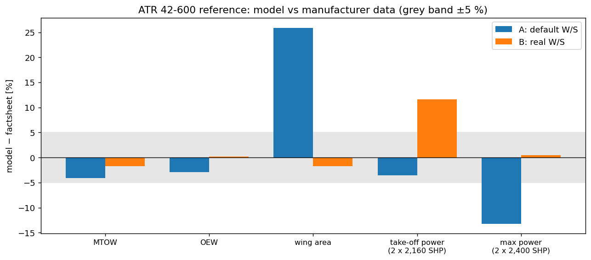
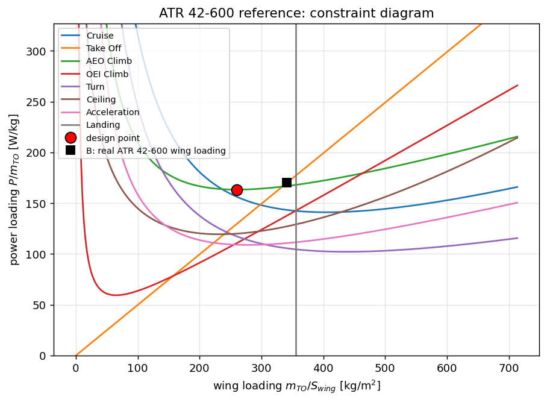
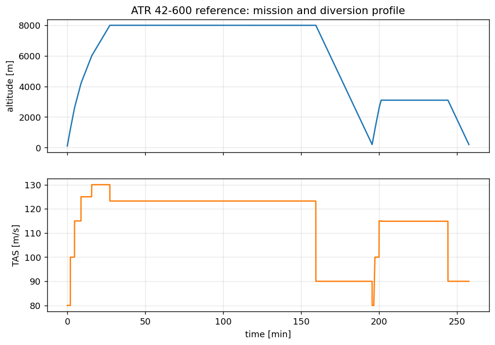
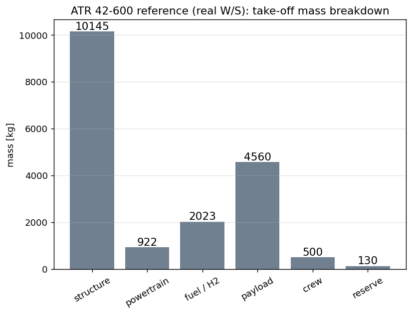
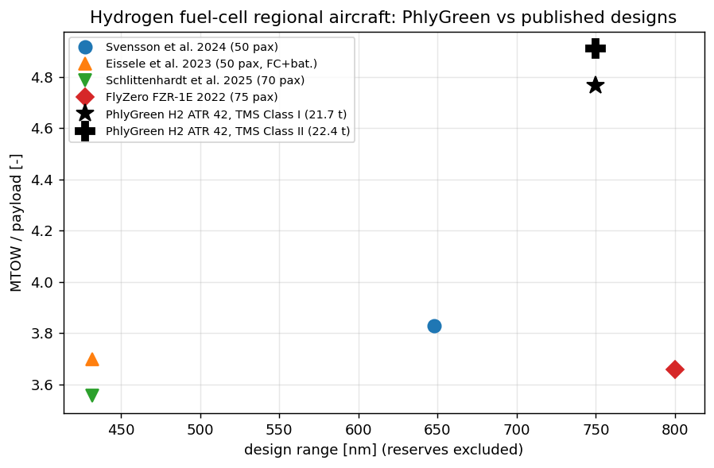
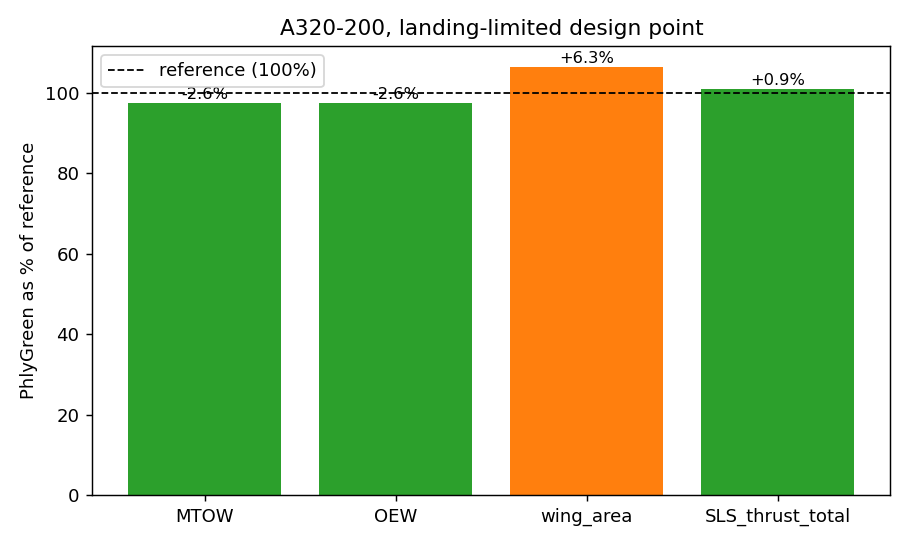
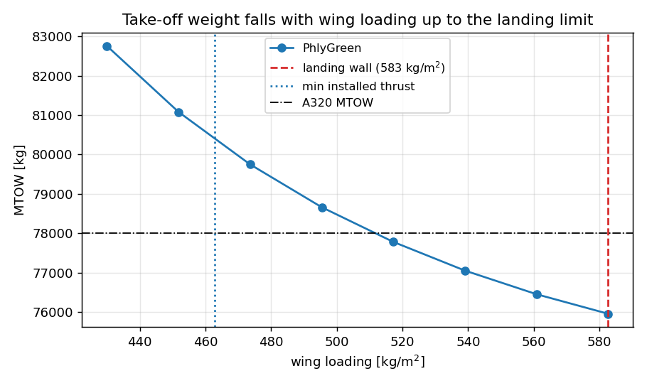
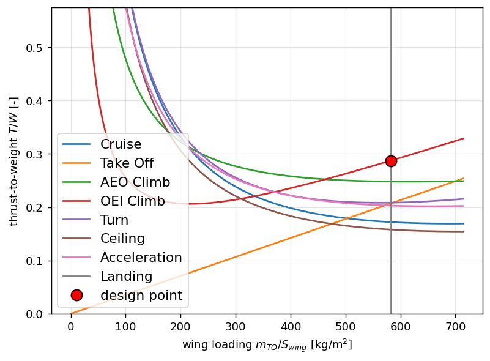
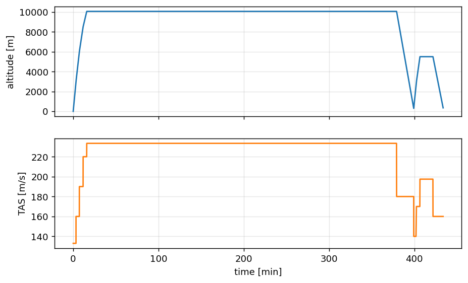
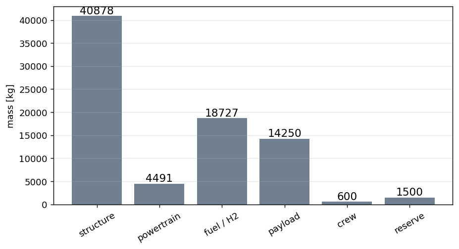

# Reference Aircraft

PhlyGreen ships two reference aircraft, both built from published data:

| | ATR 42-600 | Airbus A320-200 |
|---|---|---|
| Role | regional turboprop; baseline of every regional example (kerosene, hybrid, hydrogen) | short-haul jet; validation of the `Turbofan` configuration |
| Config | `examples/common.py: traditional_config()` | `examples/common.py: turbofan_config()` |
| Example | `examples/28_reference_atr42.py` | `examples/29_reference_a320.py` |
| Sources | ATR factsheet | Airbus ACAP, EASA TCDS (+ secondary sources, labelled) |
| Provenance | this page | this page and `trunk/validation/a320_reference.md` |

The published data set the **requirements**: take-off field, climb performance, mission,
payload. The model then **predicts** take-off weight, empty weight, wing area and installed
power, which are compared with the published values. Nothing is tuned to the published masses
or power. Both cases teach the same lesson, so it is stated up front:

!!! note "Minimum installed power is not minimum take-off weight"
    `Constraint.FindDesignPoint` picks, by default, the wing loading that minimises the
    installed power (or thrust). Real aircraft sit at a higher wing loading: a smaller wing
    gives less drag and less structure, up to the limit set by the landing field and approach
    speed. Each reference is therefore compared at two design points:

    - **A**, the default (minimum installed power);
    - **B**, the real or landing-limited wing loading.

---

## 1. ATR 42-600

### Sources

**ATR, *ATR 42-600* factsheet (2020),**
<https://www.atr-aircraft.com/wp-content/uploads/2020/07/Factsheets_-_ATR_42-600.pdf>.
Values used (as printed):

| Quantity | Factsheet | Use |
|---|---|---|
| Max take-off weight (basic) | 18,600 kg | comparison |
| Operational empty weight (Tech. Spec.) | 11,550 kg (typical in-service 11,700 kg) | comparison |
| Wing area | 54.5 m² | comparison; real wing loading 18,600/54.5 = 341 kg/m² (design point B) |
| Engines | 2 × PW127M: take-off 2,160 SHP; one-engine take-off and max continuous 2,400 SHP | comparison (3.22 / 3.58 MW for two engines) |
| Take-off distance (basic, MTOW, ISA, SL) | 1,107 m | **input**: take-off field constraint |
| Optimum climb speed | 160 KCAS | **input**: AEO-climb constraint speed |
| Rate of climb (ISA, SL, MTOW) | 1,851 ft/min | **input**: first climb segment |
| Time to climb to FL170 | 12.7 min | **input**: taper of the climb schedule |
| Max payload (typical OEW) / range with max pax | 5,300 kg / 703 nm | context for the design mission |

### Inputs

| Group | Value | Origin |
|---|---|---|
| Mission | 750 nm + 220 nm diversion; payload 4,560 kg (48 pax × 95 kg); crew 500 kg; 130 kg final reserve | design mission of the examples |
| Ground segments | taxi 13 + 13 min at 7 % power, take-off 0.7 min at 100 % | ICAO Annex 16 LTO reference values |
| Aerodynamics | quadratic polar: Cd0 0.017, AR 11, e 0.8; CL_TO 1.9, CL_land 2.6, CL_min 0.2 | generic regional turboprop |
| Take-off constraint | 90 m/s TAS, 100 m, kTO 1.2, **s_TO 1,107 m** | factsheet |
| AEO climb constraint | **160 KCAS**, 6,000 m, ROC 5 m/s, β 0.97 | factsheet speed; ROC assumed |
| OEI climb constraint | 41.4 m/s TAS, SL, gradient 2.1 % | generic |
| Cruise / ceiling / turn / acceleration | M 0.5 at 8,000 m; ceiling 9,500 m; 210 KCAS, n = 1.1; M 0.3→0.4 in 180 s | generic |
| Landing constraint | 59 m/s TAS approach, 500 m | generic |
| Climb schedule | CB 0.1175 / 0.087 / 0.056 / 0.035 / 0.022 up to 8,000 m at 80–130 m/s TAS | **1,851 ft/min** at SL; 12.5 min to FL170 (factsheet 12.7) |
| Cruise / descent | M 0.4 at 8,000 m; descent CB −0.04 at 90 m/s | design mission |
| Powertrain | η_GT 0.22 (constant), η_gearbox 0.96, η_prop 0.90; turboshaft 3.9 kW/kg; Jet-A 43.5 MJ/kg | generic |
| Structure | Class-I `'ATR'` regression (empty weight ∝ W_TO^0.94) | fitted to the ATR 42 |

### Results

| Quantity | Factsheet | A: default W/S (260 kg/m²) | B: real W/S (341 kg/m²) |
|---|---|---|---|
| MTOW | 18,600 kg | 17,843 kg (−4.1 %) | 18,281 kg (−1.7 %) |
| OEW | 11,550 kg | 11,214 kg (−2.9 %) | 11,568 kg (+0.2 %) |
| Wing area | 54.5 m² | 68.6 m² (+25.9 %) | 53.6 m² (−1.7 %) |
| Installed power vs 2 × 2,160 SHP | 3.22 MW | 3.11 MW (−3.5 %) | 3.60 MW (+11.7 %) |
| Installed power vs 2 × 2,400 SHP | 3.58 MW | 3.11 MW (−13.2 %) | 3.60 MW (+0.5 %) |

At the real wing loading (B), MTOW, OEW and wing area are within 2 % of the factsheet. The
sized power matches the 2,400-SHP one-engine / max-continuous rating within 0.5 %. The model
sizes one engine rating per aircraft, so it is compared with both published ratings.

{ width="760px" }

The constraint diagram shows why A and B differ. The default design point sits near the
minimum of the AEO-climb requirement. The real aircraft sits further right, just inside the
landing wall, at a slightly higher power loading.

{ width="600px" }

{ width="650px" }

{ width="520px" }

!!! tip "Why the requirements matter so much"
    An earlier version of the example constraints (950 m field, AEO climb at 210 KCAS,
    ≈ 2,400 ft/min initial climb) asked for ≈ 30 % more power than the real aircraft (4.2 MW).
    For a kerosene aircraft that is a modest penalty. For a fuel-cell aircraft, whose stack and
    thermal-management masses scale with power and whose heat is ≈ 1.5× its power, it inflated
    the take-off weight by ≈ 40 %. Check the power requirement against a real aircraft before
    reading anything into an electrified design.

---

## 2. Hydrogen fuel-cell variant of the ATR 42

`hydrogen_config()` keeps the ATR 42 airframe requirements, mission and payload and replaces
the powertrain:

| Input | Value |
|---|---|
| Fuel | LH₂, `Ef` = 141.87 MJ/kg (HHV, the basis of the fuel-cell efficiency) |
| Fuel cell | `PEMFC_GoodPerformance` (80 °C, 1.5 bar, λ = 2); design cell voltage 0.5 V; rated 2.5 A/cm² |
| Stack / BoP | 2,000 W/kg stack power density; BoP 40 % of the stack mass |
| Electric drive | motor 10 kW/kg, PMAD 10 kW/kg; η motor 0.96, PMAD 0.99, gearbox 0.96, propeller 0.85 |
| Storage | gravimetric index 0.35 (usable H₂ / (H₂ + tank)); tank holds load + reserve |
| Heat to the TMS | product-water vapour fraction from the cathode-exhaust saturation (see [Hydrogen](hydrogen.md#4-heat-management)) |
| TMS | Class I (5 kW/kg of heat) or Class II (geometric, see [Thermal Management](thermal-management.md)) |

| Result | TMS Class I | TMS Class II |
|---|---|---|
| MTOW | 21.7 t | 22.4 t |
| Fuel-cell rating | 3.9 MW | 4.0 MW |
| Fuel-cell system | 2.41 t | 2.50 t |
| TMS | 0.96 t | 1.11 t |

### Comparison with published fuel-cell regional designs

| Study | Aircraft | Payload | Design range | MTOW |
|---|---|---|---|---|
| Svensson, Oliveira, Grönstedt, *Int. J. Hydrogen Energy* 61 (2024) 650, [doi:10.1016/j.ijhydene.2024.02.382](https://doi.org/10.1016/j.ijhydene.2024.02.382) | ATR 42 resized, all fuel cell | 5,500 kg (50 pax) | 648 nm + reserves | 21.05 t |
| Eissele et al., *Aerospace* 10 (2023) 277, [doi:10.3390/aerospace10030277](https://doi.org/10.3390/aerospace10030277) | 50 pax, fuel cell + battery | 5,300 kg | 800 km (432 nm) + reserves | 19.6 t |
| Schlittenhardt et al., *Aerospace* 12 (2025) 249, [doi:10.3390/aerospace12030249](https://doi.org/10.3390/aerospace12030249) | 70 pax, distributed propulsion | 6,650 kg | 800 km (432 nm) | 23.64 t |
| ATI FlyZero, *Zero-carbon emission aircraft concepts*, FZO-AIN-REP-0007 (2022), FZR-1E | 75 pax, 6 propulsors | 7,875 kg | 800 nm | 28.8 t |
| **PhlyGreen** (this variant) | 48 pax, twin | 4,560 kg | 750 nm + 220 nm diversion | 21.7 / 22.4 t |

{ width="640px" }

The take-off weight is close to the comparable 50-seat designs. The ratio MTOW/payload is
≈ 25 % higher (4.8–4.9 against 3.6–3.8), for two reasons. The payload is smaller, and the
mission is longer: 750 nm with a 220 nm diversion, against at most 648 nm with a 100 nm
alternate in the others. Run with Svensson et al.'s mission inputs (648 nm + 100 nm, 5,500 kg,
gravimetric index 0.555), PhlyGreen gives 22.6 t (TMS Class I) and 23.1 t (Class II), i.e.
7–10 % above their 21.05 t.

---

## 3. Airbus A320-200

### Sources

The full provenance table, with page numbers, is in `trunk/validation/a320_reference.md`.
The validated variant is the A320-214 with CFM56-5B4, weight variant **WV017**.

| Quantity | Value | Source | Class |
|---|---|---|---|
| MTOW / MLW / MZFW | 78,000 / 66,000 / 62,500 kg | Airbus ACAP Rev. Jun 2024, §2-1-1 p. 34; EASA TCDS-N A.064.3 | primary |
| SLS take-off thrust | 2 × 12,010 daN = 240.2 kN | EASA TCDS A.064 Issue 12, §Powerplant p. 24 | primary |
| Wing span | 34.10 m | ACAP p. 40 | primary |
| Wing area | 122.6 m² | flugzeuginfo.net | secondary |
| OEW | 42,600 kg | industry figure (consistent with MZFW − max payload) | secondary |
| Typical-load range | 3,078 nm | flugzeuginfo.net | secondary |

### Inputs

| Group | Value |
|---|---|
| Mission | 3,000 nm + 200 nm alternate + 30-min hold at 1,500 ft; payload 14,250 kg (150 pax × 95 kg); crew 600 kg; reserve 1,500 kg |
| Aerodynamics | compressible polar (quadratic + Korn/Lock wave drag): Cd0 0.018, AR 9.5, e 0.80, sweep 25°, t/c 0.11, κ 0.95; CL_TO 2.0, CL_land 2.8 |
| Constraints | cruise M 0.78 at FL330; ceiling FL350 (inside the engine map's box); take-off field 2,100 m at 77 m/s; OEI gradient 2.4 %; landing approach 71 m/s; AEO climb 250 KCAS at 3,000 m, 12.7 m/s |
| Engine | pyCycle-derived turbofan map (overall efficiency, thrust lapse); nominal SLS thrust 240.2 kN; installed T/W 5.5; Jet-A 43 MJ/kg |
| Structure | Class-I `'NarrowBody'` regression, We/W0 = 4.2747 W0^−0.1844 (fit to six narrow-bodies); powertrain double count avoided |

### Results

| Quantity | Reference | A: minimum installed thrust (463 kg/m²) | B: landing-limited (583 kg/m²) |
|---|---|---|---|
| MTOW | 78,000 kg | 80,373 kg (+3.0 %) | 75,954 kg (−2.6 %) |
| OEW (secondary) | 42,600 kg | 43,407 kg (+1.9 %) | 41,478 kg (−2.6 %) |
| Wing area (secondary) | 122.6 m² | 173.6 m² (+41.6 %) | 130.4 m² (+6.3 %) |
| SLS thrust | 240.2 kN | 258.1 kN (+7.4 %) | 242.3 kN (+0.9 %) |

{ width="560px" }

Take-off weight falls with wing loading right up to the landing wall. This is why the
landing-limited point, not the minimum-thrust point, reproduces the real aircraft:

{ width="600px" }

{ width="600px" }

{ width="650px" }

{ width="520px" }

The caveats (OEW is operator-specific; the engine map stops at 35,000 ft; Class-I structure
only; emission indices referenced to the CFM56-7B27E) are listed in
`trunk/validation/a320_reference.md`.

---

## 4. Reproducing

```bash
cd trunk
python examples/28_reference_atr42.py      # ATR 42-600: inputs, comparison, figures
python examples/29_reference_a320.py       # A320-200: inputs, both design points, figures
python validation/a320_reference.py        # full A320 validation (OEW calibration, payload-range)
cd .. && python docs/scripts/make_figures.py   # regenerate every figure on this page
```
