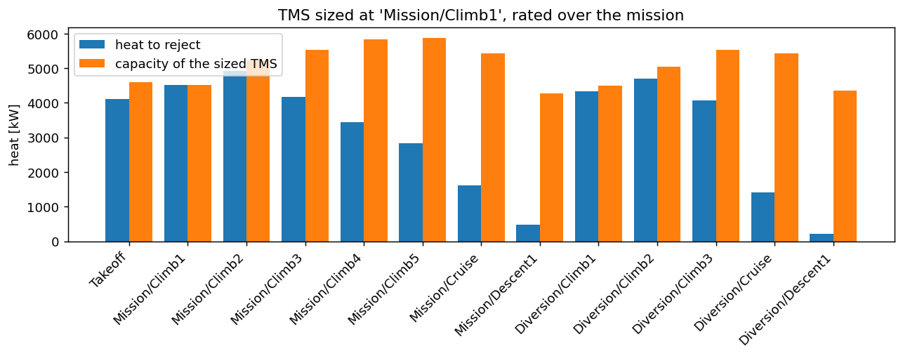
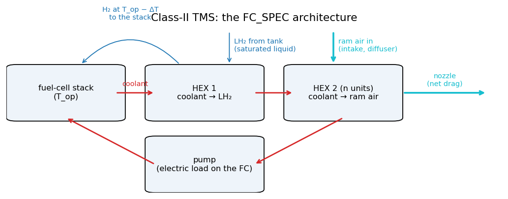
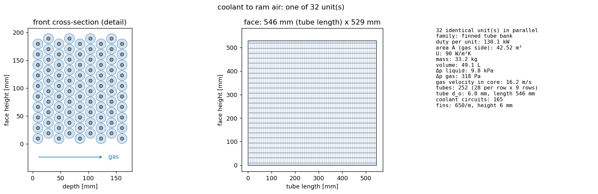
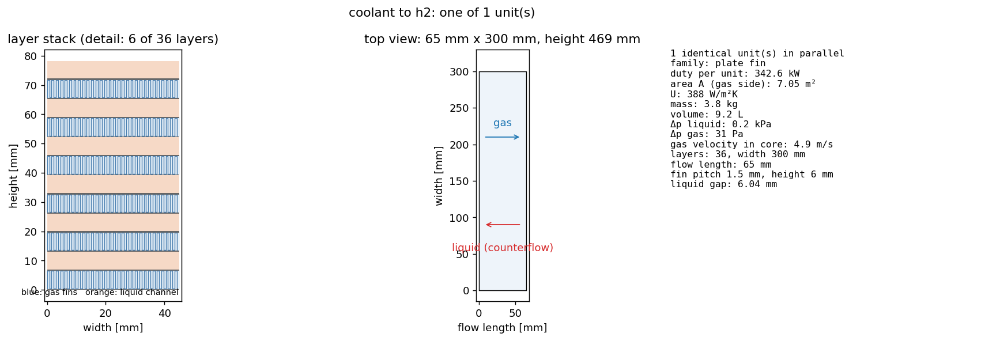
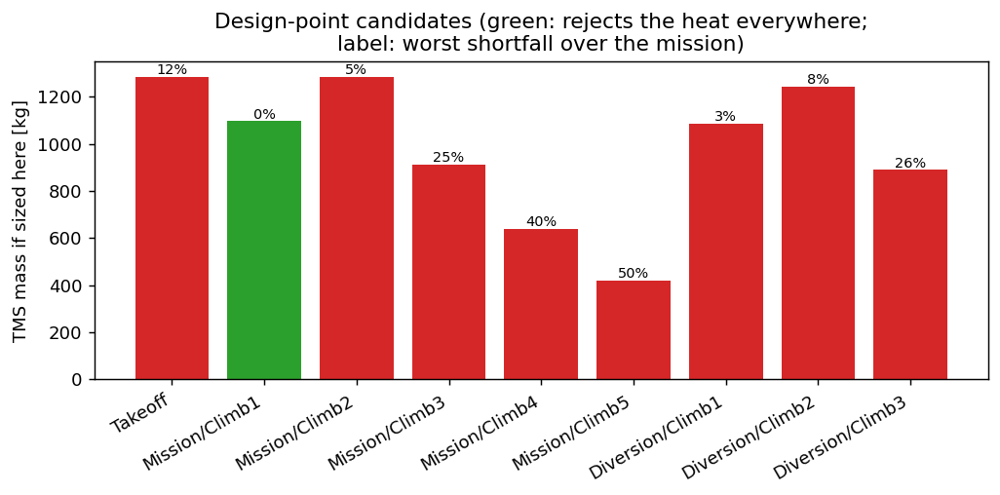
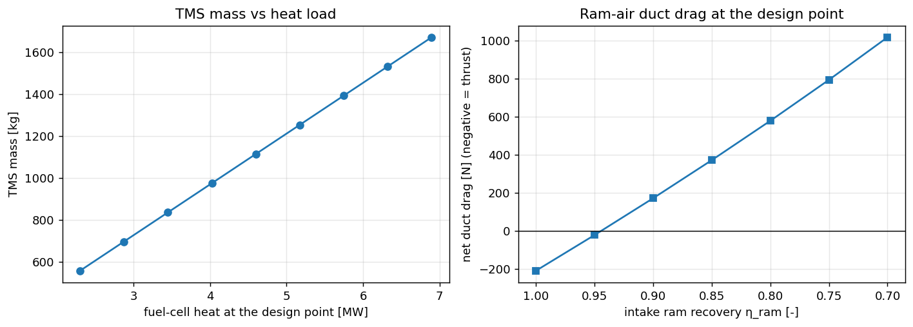

# Thermal Management (Fuel-Cell TMS)

A PEM fuel cell converts roughly half of the hydrogen energy into electricity; the rest is
low-temperature heat that the thermal-management system (TMS) must reject. PhlyGreen offers
two TMS models for the fuel-cell configurations (`'Hydrogen'` and `'FuelCellBattery'`),
selected with `TMSConfig(tms_class=...)` (legacy key `TMSInput['TMS Class']`):

| | Class I (default) | Class II |
|---|---|---|
| Model | specific power | geometric heat exchangers (FC_SPEC architecture) |
| Mass | \(Q_{\text{peak}} / \text{specific power}\) | exchanger cores + pump + pump motor |
| Drag | none | ram-air duct drag, added to the drag polar |
| Power | none | coolant pump, an electrical load on the fuel cell |
| Needs | nothing | CoolProp |
| Cost | negligible | ≈ 0.3 s per TMS sizing, ≈ 1 min per aircraft design |

---

## 1. Using the Class-II TMS

### Typed configuration

Attach a `TMSConfig` to the `AircraftConfig` of a fuel-cell aircraft. Every field except
`tms_class` is optional; see [Inputs](#5-inputs-tmsconfig-tmsinput) for the defaults.

```python
import PhlyGreen as pg
from PhlyGreen.config import TMSConfig
from common import hydrogen_config          # examples/common.py: the ATR-like hydrogen aircraft

config = hydrogen_config()
config.tms = TMSConfig(
    tms_class='II',                 # geometric model
    coolant='INCOMP::MEG-30%',      # any CoolProp fluid
    coolant_delta_t=10.0,           # [K] coolant temperature drop over the loop
    max_weight_per_unit=50.0,       # [kg] per heat-exchanger unit
    max_volume_per_unit=0.05,       # [m^3] per heat-exchanger unit
    ram_recovery=0.9,               # intake recovers 90 % of the dynamic pressure
)

aircraft = pg.build_aircraft()
aircraft.configure(config)          # sizes the aircraft with the Class-II TMS in the loop

r = aircraft.results()
print(f"MTOW {r.WTO:.0f} kg, TMS {r.tms_mass:.0f} kg (class {r.tms_class}), "
      f"pump {r.tms_pump_power/1e3:.1f} kW, ram drag {r.tms_ram_drag:.0f} N, "
      f"sized at '{r.tms_design_point}'")
aircraft.tms.report()

# The chosen hardware, rated at every mission point: heat to reject vs capacity.
tms, result = aircraft.tms, aircraft.weight.tms_result
for point in aircraft.mission.thermal_profile:
    q_cap, q_req = tms.RateAtPoint(result, point, capped=False)
    print(f"{point['name']:20s} required {q_req/1e3:7.0f} kW   capacity {q_cap/1e3:7.0f} kW")
```

Output (abridged):

```text
MTOW 22471 kg, TMS 1108 kg (class II), pump 32.3 kW, ram drag 168 N, sized at 'Mission/Climb1'
TMS Class II: design point 'Mission/Climb1' (Q_fc = 4568 kW)
  coolant_to_h2       :   1 x plate_fin            3.9 kg  0.0093 m3 per unit,   346.2 kW
  coolant_to_ram_air  :  32 x finned_tube_bank    33.0 kg  0.0488 m3 per unit,  4136.0 kW
  pump: 32.3 kW, 46.8 kg;  ram air: 82.2 kg/s, drag 168 N
  total TMS mass: 1107.8 kg
  duct drag work over the mission: 15.1 MJ (momentum balance) vs 376.9 MJ charged by the constant drag increment
Takeoff              required    4059 kW   capacity    4577 kW
Mission/Climb1       required    4482 kW   capacity    4482 kW
Mission/Climb2       required    4869 kW   capacity    5028 kW
Mission/Cruise       required    1624 kW   capacity    5390 kW
...
```

{ width="760px" }

The design point is the first climb segment. It is not the point with the most heat (that is
Climb2), but at 80 m/s it has the least ram air. The geometry sized there rejects the heat
everywhere else with margin, while a geometry sized at Climb2 would fall short at Climb1.
If even `max_hex_units` units cannot keep each unit within the mass/volume caps, the report
flags `[per-unit caps exceeded]` and a warning is issued; raise `max_hex_units` or the caps to
remove it.

The drag-work line comes from the check of the hardware along the mission
([below](#checking-the-hardware-along-the-mission)). Over the mission, the constant drag
increment of the aircraft charges 25 times the duct drag work of the momentum balance, so the
aircraft carries the duct drag conservatively. The hardware rejects the heat, stays within its
pressure budgets and does not choke at any point of the mission, and the coolant-side wall
stays above the coolant freezing point.

### Legacy dictionaries

```python
aircraft.DesignAircraft(AerodynamicsInput, ConstraintsInput, MissionInput, EnergyInput,
                        MissionStages, DiversionStages,
                        TMSInput={'TMS Class': 'II', 'TMS Ram Recovery': 0.9})
```

Without `TMSInput` (or with `'TMS Class': 'I'`) the Class-I model is used.

### What the design exposes

| Where | What |
|---|---|
| `aircraft.results()` | `tms_class`, `tms_mass`, `tms_pump_power` [W], `tms_ram_drag` [N], `tms_design_point` |
| `aircraft.weight.WHeat_Exchanger` | TMS mass in the take-off-weight balance (the `cooling` item of the mass breakdown) |
| `aircraft.weight.tms_result` | the `FCThermalManagementResult`: `units` (per role: `design`, `n_parallel`, family, geometry), `mdot_coolant`, `mdot_ram_air`, `capture_area`, `pump_power`, `pump_mass`, `hex_mass`, `ram_drag`, `ram_drag_raw`, `heat_balance`, `candidates` (design-point selection table) |
| `aircraft.weight.tms_result.checks` | `tms.CheckAtPoint` of the chosen hardware at every profile point and every integration point of the mission (see [Checking the hardware](#checking-the-hardware-along-the-mission)); `tms_result.violations()` lists the broken limits |
| `aircraft.mission.thermal_profile` | the heat-load points the TMS is sized and rated on |
| `aircraft.mission.thermal_history` | the same quantities at every accepted integration point of the mission |
| `aircraft.fuelcell.P_aux_tms` | pump power carried by the fuel cell [W] |
| `aircraft.aerodynamics.extra_Cd` | ram-air drag increment on the polar |

### Sizing at a single point

The subsystem can also be used on its own, e.g. for trade studies at fixed conditions:

```python
tms = aircraft.tms                  # after configure(...) with tms_class='II'
point = {'name': 'climb', 'Q_fc': 4.0e6, 'altitude': 2000.0, 'V_inf': 100.0, 'mdot_h2': 0.05}
res = tms.SizeAtPoint(point)        # FCThermalManagementResult
print(res.total_mass, res.pump_power, res.ram_drag)
q_rejected, q_required = tms.RateAtPoint(res, {**point, 'altitude': 6000.0, 'V_inf': 130.0})
```

`examples/27_hydrogen_tms_class_ii.py` compares Class I and Class II on the same aircraft,
prints the design-point selection, plots the rating over the mission and shows the effect of
the intake ram recovery.

---

## 2. Heat load

The fuel-cell heat is the stack heat of the Kulikovsky cell model
(see [Hydrogen](hydrogen.md#4-heat-management)). `Mission` records it along the mission in
`mission.thermal_profile`, a list of points `{name, Q_fc, altitude, V_inf (TAS), mdot_h2}`:

- the **take-off/OEI point**, where the fuel cell delivers the worst-case off-mission power at
  the take-off constraint conditions (not flown by the profile);
- the **peak of each flown segment**, named `Mission/<stage>`, `Diversion/<stage>`, ....

`mission.TO_FC_Thermal_Pwr` and `mission.Max_FC_Thermal_Pwr` are the take-off and in-flight peaks.

## 3. Class I

\[
W_{\text{TMS}} = \frac{\max(Q_{\text{mission peak}},\; Q_{\text{take-off}})}{\text{HEX specific power}},
\]

with the specific power `EnergyConfig.hex_specific_power_h2` (default 5000 W/kg). The take-off
point is included because the fuel cell is sized there and rejects the most heat there.

## 4. Class II: the FC_SPEC architecture

{ width="760px" }

At a design point with stack heat \(Q_{fc}\):

1. **Reactant heat.** Hydrogen and cathode air enter the stack below \(T_{op}\) and absorb
   \(q_{\text{react}} = \dot m_{H_2}\,[h(T_{op}) - h(T_{op}-\Delta T_{H_2})] + \dot m_{\text{air}}\,c_p\,(T_{op} - T_{\text{comp}})\).
   The cathode air flow follows from the hydrogen flow and the air stoichiometry, and
   \(T_{\text{comp}}\) is the compressor delivery temperature. The coolant rejects
   \(Q_{\text{ext}} = Q_{fc} - q_{\text{react}}\).
2. **Coolant loop.** The coolant leaves the stack at \(T_{op}\) and returns
   \(\Delta T_{\text{loop}}\) colder, so \(\dot m_c = Q_{\text{ext}}/(c_p\,\Delta T_{\text{loop}})\).
3. **HEX 1 (coolant → H2).** The fixed duty warms the hydrogen from saturated liquid at the
   supply pressure to \(T_{op} - \Delta T_{H_2}\):
   \(q_1 = \dot m_{H_2}\,[h(T_{op}-\Delta T_{H_2}) - h_{\text{sat,liq}}]\). Enthalpies are for
   para-hydrogen from CoolProp, so the latent heat is included. In the ε-NTU method the
   hydrogen carries an *effective* \(c_p = \Delta h / \Delta T\).
4. **HEX 2 (coolant → ram air).** This exchanger rejects the remainder \(q_2 = Q_{\text{ext}} - q_1\).
   The ram air enters at the free-stream total temperature and its temperature rise is
   \(\min(\Delta T_{\text{air}},\; \varepsilon_{\max}\,(T_{c,in} - T_{0}))\), which fixes the ram-air mass flow.
5. **Pump.** \(P_{\text{pump}} = \dot V_c\,\Delta p_{\text{loop}} / (\eta_{\text{pump}}\,\eta_{\text{motor}})\);
   the mass is \(P/\text{sp}_{\text{pump}} + P/\text{sp}_{\text{motor}}\). The stack channels
   and the piping take `stack_pressure_drop` of the loop pressure rise; the two exchanger
   cores share the rest.
6. **Ram-air drag.** This uses a Meredith-type momentum balance of the duct (`Systems/Thermal/ram_air.py`).
   The free stream is decelerated in the intake, which recovers a fraction \(\eta_{\text{ram}}\)
   of the dynamic pressure, \(p_{0,1} = p_\infty + \eta_{\text{ram}}(p_{0,\infty} - p_\infty)\).
   The air is heated at the core velocity (Rayleigh flow), loses the core pressure drop, and is
   expanded back to ambient pressure: \(D = \dot m\,(V_\infty - V_{\text{exit}})\). Negative
   values (net thrust) are reported in `ram_drag_raw` and clipped to zero in `ram_drag`.

### Exchanger sizing (`Systems/Thermal/hex.py`)

For each role, three families are sized and the lightest one that respects the per-unit
caps is kept:

| Family | Liquid side | Gas side | Arrangement |
|---|---|---|---|
| Plain tube bank (staggered, square pitch) | Gnielinski / laminar Nu = 3.66 | Zukauskas, with row correction; Jakob pressure drop (as given in Holman) | cross-flow, gas mixed |
| Annular-finned tube bank (Al fins, steel tubes) | Gnielinski / laminar Nu = 3.66 | Briggs & Young; Schmidt fin efficiency | cross-flow, gas mixed |
| Plate-fin (Al, offset-strip fins) | plain channel, Gnielinski / laminar Nu = 7.54 | Manglik & Bergles j and f | counterflow |

- **ε-NTU.** The relations are the closed forms of Incropera's Table 11.3. For cross-flow with
  one stream mixed, the relation depends on whether the mixed (gas) stream has the smaller or
  the larger heat-capacity rate.
- **Layout.** The design velocities (1.75 m/s for liquids, 15 m/s for gases) fix the flow
  areas: tube circuits, the gas face area, and the number of plate-fin layers. The required
  area then fixes the bank depth or the core length. The fin pitch is set from the fin
  diameter, so adjacent fins never overlap, and the fin densities stay within the tested
  range of Briggs & Young.
- **Self-consistency.** U is recomputed from the real velocities of the built layout, and the
  area is iterated until the two agree. Sizing and rating use the same layout and
  correlations, so rating a unit at its own design point returns its design duty.
- **Reference area.** U is referred to the gas-side area; the liquid-side and wall resistances
  are scaled by the area ratio.
- **Parallel units.** Each role uses the fewest identical units in parallel such that one unit
  respects `max_weight_per_unit` and `max_volume_per_unit`. If even `max_hex_units` units
  cannot, the units are allowed to exceed the caps and a warning is issued.
- **Pressure-drop limits.** The air-side pressure drop is limited to the recovered dynamic
  pressure, \(\eta_{\text{ram}}\,q_\infty\). The H2 side is limited to 10 kPa. On the liquid
  side the two cores are in series and share the loop pressure rise minus the stack and
  piping drop, \(\Delta p_{\text{loop}} - \Delta p_{\text{stack+piping}}\): HEX 1 may use all
  of it, HEX 2 what HEX 1 leaves.

The drawings below show one unit of each role of the hydrogen example (to scale; large cores
are shown as a detail), generated with `PhlyGreen.Systems.Thermal.plotting.draw_hex`:





```python
from PhlyGreen.Systems.Thermal.plotting import draw_hex, plot_tms_rating
for unit in aircraft.weight.tms_result.units:
    draw_hex(unit.design, n_parallel=unit.n_parallel).savefig(f"{unit.role}.png")
```

### Design point

The hardware must reject the heat at every mission point, and the point with the most heat is
not necessarily the one that needs the heaviest exchangers. `tms.SizeForMission(profile)`:

1. sizes the TMS at every point of `thermal_profile` carrying at least half of the peak heat;
2. **rates** each geometry at every point, with the hardware fixed: the coolant flow is set by
   the pump, the air flow by the intake capture area (\(\dot m = \rho V A_{\text{capture}}\),
   flap fully open), and U is recomputed at the new flows;
3. keeps the lightest geometry whose worst shortfall is within 2 %. If none qualifies, it keeps
   the least-short one and issues a warning;
4. rates the kept geometry at every accepted integration point of the mission
   (`mission.thermal_history`). A point inside a segment can carry less heat than the segment
   peak and still need more cooling, for example at a lower speed. If the hardware falls short
   there by more than 2 %, the worst such point joins the candidates and the rated points, and
   steps 1-3 are repeated (at most three times). When the hardware is not short anywhere along
   the mission, this step changes nothing.

{ width="640px" }

In the hydrogen example only the first climb segment gives hardware that rejects the heat
everywhere. Lighter geometries sized at higher, faster points fall short at the slow early
climb; heavier ones (take-off, Climb2) are not needed.

### Checking the hardware along the mission

`tms.CheckAtPoint(result, point)` gives the operating state of the fixed hardware at one point.
The coolant flow is the pump flow. When the open intake would reject more heat than required,
the flap throttles the air flow to the one that rejects the required heat. The check reports:

- the heat rejected against the heat to reject;
- the coolant-side pressure drop of the two cores against the loop budget
  \(\Delta p_{\text{loop}} - \Delta p_{\text{stack+piping}}\);
- the air-side pressure drop of the ram-air core against the recovered dynamic pressure;
- thermal choking of the duct;
- the duct drag of the momentum balance, and the drag the aircraft charges at that point
  through the constant ΔCd;
- the lowest coolant-side wall temperature of the cores (the coolant leaving a core against
  the cold stream entering it) against the coolant freezing point. The freezing point is
  CoolProp's `T_freeze` of the coolant (258.6 K for `INCOMP::MEG-30%`). Fluids without
  CoolProp freezing data are not checked.

The outputs are sorted by what the model can resolve:

| Output | Treated as | Reason |
|---|---|---|
| heat (shortfall above 2 %) | violation | the hardware is sized against it with the same correlations |
| core coolant pressure drop vs loop budget | violation | same: a sizing constraint of the cores |
| ram-air core pressure drop vs recovered dynamic pressure | violation | same |
| thermal choking of the duct | violation | same |
| coolant-side wall below the freezing point | risk | the wall estimate uses core-average film resistances and single-stream hydrogen properties at the cold end; it flags the risk but cannot decide a margin of a few kelvin |
| duct drag, point by point | not checked | the aircraft carries the duct drag as a constant ΔCd. It is compared over the mission as a drag work (`ram_drag_work` vs `ram_drag_work_accounted`). On the reference design the local excess at the start of climb is 71 N, 0.6 % of the aircraft drag, below the accuracy of the drag polar |

At the converged design, `tms.CheckMission` runs this check at every profile point and every
integration point, stores it in `tms_result.checks` and integrates the two drag works.
`tms_result.violations()` and `tms_result.risks()` list one message per broken limit or
flagged risk; each one is issued as a `RuntimeWarning`, and `tms.report()` prints them with
the drag-work line. `fly_off_design` in `examples/30_off_design_mission.py` runs the same check
on the flown off-design mission: broken limits are violations, risks go to `risks`.

### Coupling to the aircraft

`Weight._fuel_cell_and_tms_closure` is shared by `Weight.Hydrogen` and
`Weight.FuelCellBattery`, so a battery-free fuel-cell + battery design is identical to the
hydrogen one. Each weight iteration repeats the following until the fuel-cell power, the pump
power and the drag increment all converge:

1. fly the mission;
2. size the TMS from the thermal profile;
3. set the pump power as `fuelcell.P_aux_tms`, a constant electrical load. It is added to the
   electrical demand at every operating point and to the stack rating, so its hydrogen is
   flown and the stack is sized for it;
4. set the ram drag as `aerodynamics.extra_Cd`, \(D / (q_{\text{design}}\,S)\) with
   \(S = W_{TO}\,g/(W/S)\). A constant ΔCd scales the duct drag with the dynamic pressure at
   every flight condition;
5. resize the fuel cell.

The constraint diagram is computed before the weight loop, so the duct drag does not move the
design point (W/S, P/W). It does act on the mission, the take-off and the OEI powers.

{ width="760px" }

Left: the TMS mass grows smoothly with the heat load (the per-unit caps change the number of
units, not the trend). Right: the net duct drag at the design point against the intake ram
recovery. With an ideal intake the heated air leaves faster than it entered (Meredith effect)
and the duct gives a small thrust; a few percent of lost dynamic pressure turns it into drag.

## 5. Inputs (`TMSConfig` / `TMSInput`)

| Field | Legacy key | Default | Meaning |
|---|---|---|---|
| `tms_class` | `TMS Class` | `'I'` | `'I'` or `'II'` |
| `coolant` | `TMS Coolant` | `INCOMP::MEG-30%` | CoolProp coolant name |
| `coolant_delta_t` | `TMS Coolant DeltaT` | 10 K | coolant temperature drop over the loop |
| `max_volume_per_unit` | `TMS Max Volume Per Unit` | 0.05 m³ | per-unit volume cap |
| `max_weight_per_unit` | `TMS Max Weight Per Unit` | 50 kg | per-unit mass cap |
| `max_hex_units` | `TMS Max HEX Units` | 100 | max parallel units per role |
| `ram_air_delta_t` | `TMS Ram Air DeltaT` | 50 K | design ram-air temperature rise |
| `ram_air_max_effectiveness` | `TMS Ram Air Max Effectiveness` | 0.8 | cap on that rise, as a fraction of the inlet ΔT |
| `h2_approach_delta_t` | `TMS H2 Approach DeltaT` | 30 K | H2 leaves HEX 1 at \(T_{op}\) minus this |
| `h2_supply_pressure` | `TMS H2 Supply Pressure` | 1.6 bar | LH2 enters HEX 1 saturated at this pressure |
| `loop_pressure_drop` | `TMS Loop Pressure Drop` | 2 bar | pump pressure rise (stack, piping, cores) |
| `stack_pressure_drop` | `TMS Stack And Piping Pressure Drop` | 0 bar | part of the loop rise taken by the stack channels and the piping; the cores share the rest (must be below `loop_pressure_drop`) |
| `pump_efficiency` | `TMS Pump Efficiency` | 0.75 | |
| `pump_motor_efficiency` | `TMS Pump Motor Efficiency` | 0.95 | |
| `pump_specific_power` | `TMS Pump Specific Power` | 800 W/kg | |
| `pump_motor_specific_power` | `TMS Pump Motor Specific Power` | 5000 W/kg | |
| `ram_recovery` | `TMS Ram Recovery` | 1.0 | fraction of the dynamic pressure the intake recovers |
| `takeoff_coolant_overtemperature` | `TMS Takeoff Coolant Overtemperature` | 0 K | coolant/stack allowed above \(T_{op}\) at the take-off point only |

None of the defaults is calibrated against flight hardware. There is no sourced value for the
stack and piping pressure drop; its default of 0 gives the whole loop rise to the cores.

## 6. Limitations

- **Core-only mass.** Headers, manifolds, ducts, piping, the coolant inventory and the
  mounting structure are not included.
- **No fouling resistance.** The finned-bank air-side friction factor (\(f = 1.5\,Re^{-0.2}\))
  is an approximation without a literature source.
- **Drag is a lower bound.** With the default ideal intake (`ram_recovery = 1`), the Meredith
  heating can recover more momentum than the core loses, and the clipped drag is zero. There is
  no spillage or cowl drag, so use `ram_recovery < 1` for a realistic duct. The aircraft
  carries the duct drag as a constant ΔCd fixed at the design point. Over the mission this
  charges more drag work than the momentum balance, while at single points (the start of
  climb) the momentum balance can give slightly more.
- **No fans.** Take-off and low-speed points are cooled by ram air only. When take-off is the
  largest heat load at the lowest speed, it sizes the exchangers. Two levers reduce that
  penalty:
  - letting the coolant run hotter for the short take-off phase
    (`takeoff_coolant_overtemperature`; e.g. 95 °C against 80 °C nominal);
  - covering part of the take-off power with a battery (`'FuelCellBattery'` with a take-off
    `phi`).
  When the power requirement comes from the climb rather than the take-off, the climb point
  sizes the TMS and neither lever has an effect.
- **Coolant freezing is a flagged risk, not a design constraint.** HEX 1 has a water-glycol
  coolant facing hydrogen at ≈ 20 K. The check compares an estimate of the lowest coolant-side
  wall temperature with the freezing point and reports a risk. The estimate uses the
  core-average film resistances and single-stream hydrogen properties, so it does not resolve
  the temperature field at the cold end of the core, and the sizing does not change the
  geometry to avoid it. A design that flags the risk needs a finer model of HEX 1 or an
  architecture that keeps the coolant away from the cryogenic hydrogen (an intermediate loop
  or a hydrogen preheater), neither of which is modelled.
- **Physics not included.** Ortho/para conversion is not modelled (pure para-hydrogen
  enthalpies). The stack is assumed to hold \(T_{op}\) at all loads. There are no transients.
